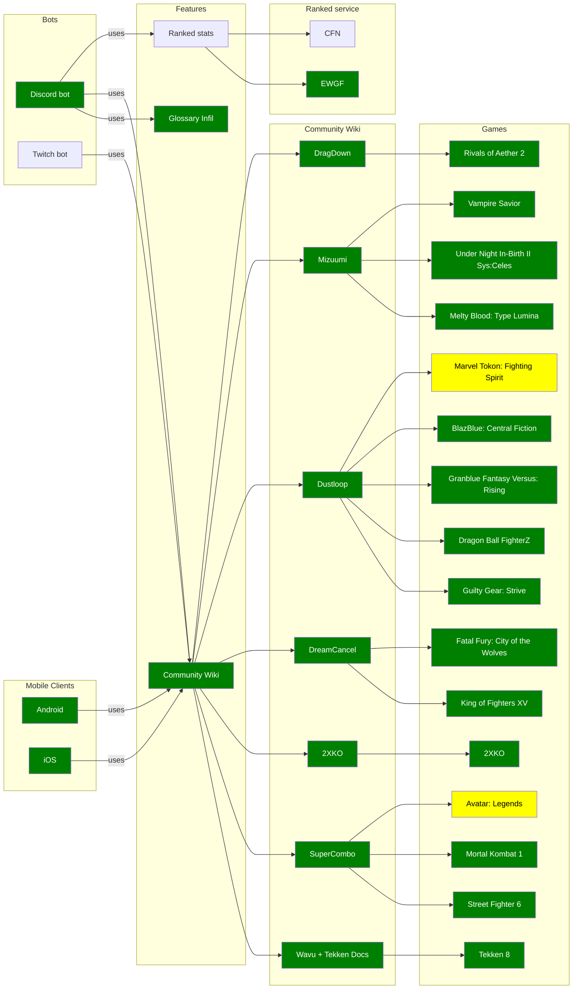

# FIGHTING NERD - FGC frame data

Frame data targeting Discord bot and mobile apps:
- 🌐 multiplatform:
  - Play Store [](https://play.google.com/store/apps/details?id=io.github.sophon.fightingnerd)
  - App Store [](https://apps.apple.com/us/app/fighting-nerd/id6793185357)
  - Discord [](https://discord.com/discovery/applications/1438716136790429776)
- 🧩 highly extensible
  - 📘 glossary: Infil Glossary
  - 📚 community wikis: [DustLoop](https://www.dustloop.com/wiki/), [DreamCancel](https://dreamcancel.com/wiki/Main_Page), [Mizuumi](https://mizuumi.wiki/w/Main_Page), [SuperCombo](https://wiki.supercombo.gg/w/Main_Page), [Wavu](https://wavu.wiki/), [DragDown](https://dragdown.wiki/wiki/Main_Page), [2xko](https://wiki.play2xko.com/en-us/)
  - ELO service: [EWGF.gg](https://ewgf.gg/)


[](https://ko-fi.com/sorryuken)

[](https://buymeacoffee.com/sophon)

This README serves as a technical overview for the project.


### Tech stack

- core
  - language: `Kotlin`
  - concurrency: `Coroutines` and `Flow`
  - networking: `Ktor`
  - serialization: `kotlinx.serialization`
  - DI: `Koin`
- platforms
  - `Kotlin Multiplatform` - Android, iOS and JVM
  - Discord API - `Kord`
- logging - `Napier`
- data
  - DB - `SQLDelight`
  - preferences - `DataStore`
- testing and quality
  - unit tests - `JUnit 4`, `AssertK`
  - architecture testing - `Konsist`
  - lint: `Detekt`
- mobile
  - UI: `Compose Multiplatform` 
  - navigation: `navigation 3`
  - media: `Coil` for images, `Compose Media Player` for videos
  - IAP (donations): `RevenueCat`
  - store: `Play Review`
- Discord bot
  - containerization: `Docker`
  - cloud hosting: `Fly.io`
- others
  - versioning: `BuildKonfig`

### Architecture

- Hexagonal architecture + DDD: see [ARCHITECTURE.md](docs/ARCHITECTURE.md)
- multi-module: see [modules.mmd](docs/modules.mmd)
  - core 
  - composeApp - mobile clients
  - bot/discord - Discord bot
  - feat/admin - administrative tasks
  - feat/ewgf - ELO service
  - feat/glossaryInfil - FGC glossary
  - feat/stats - usage tracking, daily reports
  - feat/wiki - frame data from various wikis

### AI disclaimer

- October 2025 (project start) - June 2026: completely human coded.
- June 2026 - onwards: AI assisted.

Specific breakdown:

- completely human created/decided:
  - architecture
  - interfaces
  - code reviews and commits
  - features
  - documentation
  - releases
  - all project assets - banners, icons, screenshots etc.
- AI assisted, complete human supervision:
  - unit tests
  - minor refactoring using IDE MCP
  - comments
  - CICD
- AI written, minimal human supervision:
  - data models from json

### Current features



### [Long term goals](https://github.com/Sophon/FightingNerd/wiki/Features#planned-feature-modules):
- Twitch bot
- ELO rank services

___
# [License](LICENSE.txt)
```
License: Apache 2.0 with Commons Clause

Licensed under the Apache License, Version 2.0 (the "License");
you may not use this file except in compliance with the License.
You may obtain a copy of the License at

    http://www.apache.org/licenses/LICENSE-2.0

Unless required by applicable law or agreed to in writing, software
distributed under the License is distributed on an "AS IS" BASIS,
WITHOUT WARRANTIES OR CONDITIONS OF ANY KIND, either express or implied.
See the License for the specific language governing permissions and
limitations under the License.

Additional restriction: Commons Clause - you may not sell the software 
or offer it as a service. See LICENSE.txt for full terms.

© 2025 Sophon
```


